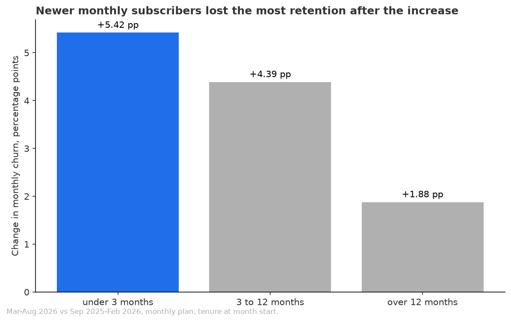
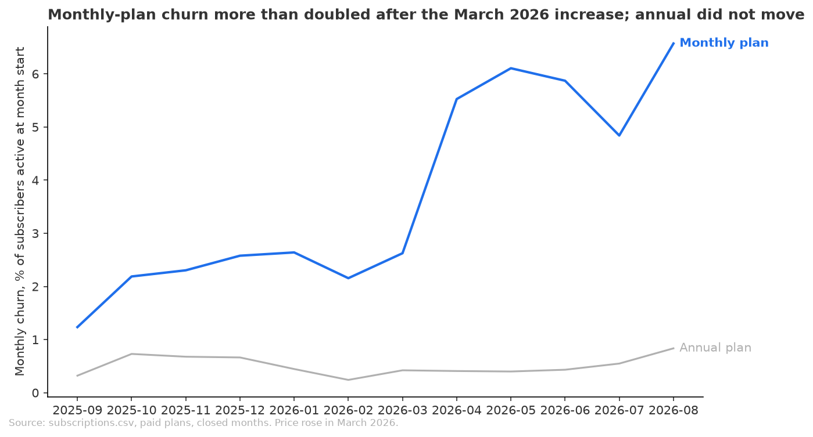

# The March 2026 increase hurt monthly-plan retention across the board, most for newer subscribers

**Recommendation:** The data does not support a narrow rollback aimed at one group, because every group lost retention. If a rollback is tested, start with monthly subscribers in their first year, who lost the most, and measure it against a held-back group before rolling it out wider.

## Key Takeaways
- Monthly-plan churn rose from 2.22% a month (Sep 2025 to Feb 2026) to 5.25% (Mar to Aug 2026), up 3.03 percentage points, or 136.78% relative.
- The annual plan, which was not repriced, stayed flat at 0.52% before and 0.51% after, and the same months a year earlier moved by only -0.11 percentage points on the monthly plan.
- Subscribers with under 3 months of tenure lost the most, +5.42 percentage points (3.14% to 8.55%), against +1.88 percentage points (1.05% to 2.93%) for those over 12 months.
- The rise holds when the tenure mix is held at the earlier mix (+3.34 percentage points) and without the September 2025 signup spike (+2.95 percentage points).
- Churn jumped in April 2026 (5.53%), not March (2.62%), and stayed between 4.84% and 6.57% through August.

## Who it hit
Every group moved up by at least 2 percentage points, so the damage is broad, not concentrated. The gaps are in size:

- Tenure: under 3 months +5.42, 3 to 12 months +4.39, over 12 months +1.88 percentage points.
- Country: EU +3.63, India +3.61, Rest +3.29, US +2.34 percentage points.
- Device: Web +3.58, Android +3.48, iOS +2.17 percentage points.
- Subscribers who joined from March 2026 churn at 10.14% a month, with no earlier period to compare against.

## What this does not show
- Timing, not proof of cause. Nothing else is known to have changed in March 2026, but product, marketing and acquisition changes were not tested.
- Whether people left because of price. The data has no cancellation reason.
- Revenue. A higher price on fewer subscribers may or may not pay off; this was not measured.
- The rise is broad, so a rollback for one segment would leave most of the lost retention in place.
- Some segments are small: subscribers who joined Oct 2025 to Feb 2026 had only 29 churn events before the increase.

## Checks
- Review verdict: Think on it
- Ran and passed: no join fan-out on either join, segments add back to the totals, free plans and scheduled starts excluded, September 2026 left out as an open month, and the result rechecked at matched tenure and without the September 2025 cohort.
- Not verified: whether anything else changed in March 2026.
- Not verified: the reason for cancelling, and involuntary versus chosen cancellation.
- Not verified: the revenue effect of the increase.
- Not verified: statistical uncertainty on the segment differences, and the small segments named above.
- Not verified: why churn jumped in April and not March, though every monthly payment from March was at $12.

## Sources
- Script: `analysis.py`
- Monthly vs annual, placebo → `data/churn_by_plan.csv`
- Tenure, country, device, cohort → `data/monthly_churn_by_tenure.csv`, `data/monthly_churn_by_country.csv`, `data/monthly_churn_by_device.csv`, `data/monthly_churn_by_cohort.csv`
- Tenure-matched result → `data/tenure_matched_summary.csv`
- Without September 2025 cohort → `data/sensitivity_without_sep_2025_cohort.csv`
- Month by month → `data/monthly_churn_series.csv`
- Price paid → `data/price_check.csv`
