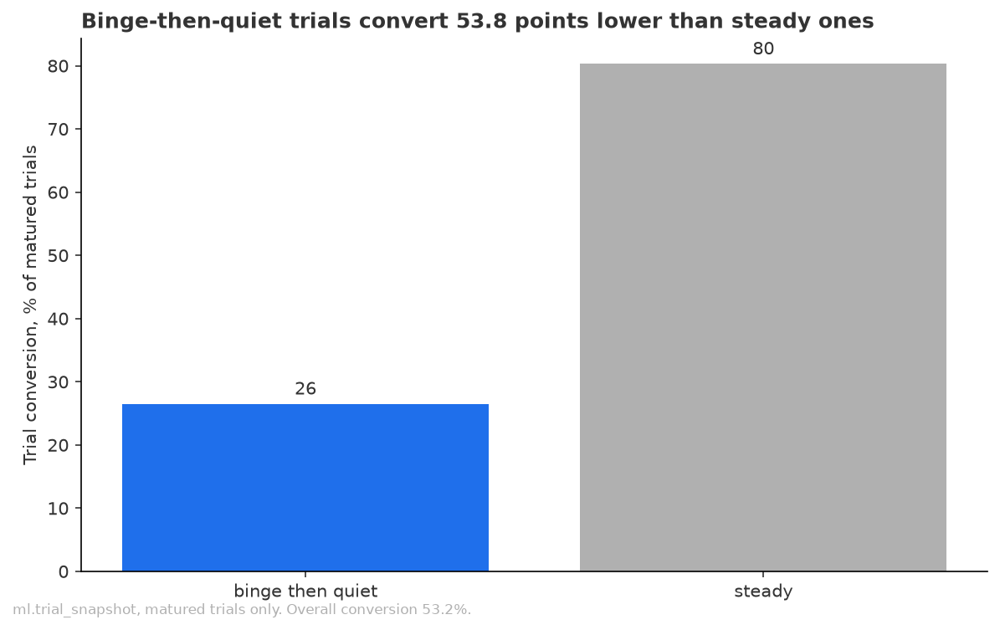
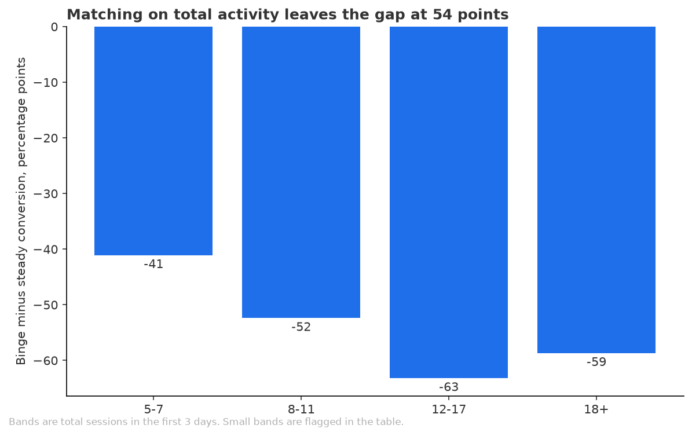

# Trial users who binge on day one and go quiet convert far worse, but an email may not close the gap

**Recommendation:** Do not roll out spread-out nudges to all trial users yet. The gap is large and holds everywhere, so it is worth testing: send the spread-out email to a random half of new trial users and compare conversion with the other half. The data shows who converts, not whether changing behaviour would change the outcome.

## Key Takeaways
- Binge-then-quiet trials converted at 26.48%, against 80.26% for steady trials, a gap of -53.78 percentage points (95% range -59.83 to -47.58), or -67.01% relative.
- Overall conversion across all matured trials with early-usage data was 53.23%, so bingers sit 26.75 points below that average and steady users 27.03 points above it.
- The gap is not a heavy-against-light story: the two groups averaged about the same activity (13.18 and 12.08 sessions in the first three days), and at matched activity the gap is -54.13 percentage points.
- It holds in every country (from -47.80 in the EU to -59.76 in the US), on every device (from -47.37 on web to -58.78 on iOS), and under other cut-offs for "binge" and "steady" (from -50.19 to -60.03 percentage points).
- Light users, with fewer than 5 sessions in three days, converted at only 15.85%, the lowest group, so low engagement matters more than the shape of it.

## Who it hit
The binge-then-quiet group is 253 trials and the steady group is 765, out of 1,516 matured trials. The binge group's usage drops from 11.34 sessions on day one to 0.96 and 0.87 on days two and three; the steady group uses about 4 a day throughout. The gap is similar across activity levels:

- Activity of 5 to 7 sessions: -41.14 percentage points.
- 8 to 11 sessions: -52.39.
- 12 to 17 sessions: -63.24.
- 18 or more sessions: -58.66.

## What this does not show
- Cause. The steady group is defined by coming back on days two and three, which is itself a sign of interest. Users who intend to subscribe may simply return, so spreading usage out may not change anyone's decision.
- A gap this large is unlikely to be closed by an email. Treat it as a reason to test, not as the size of the prize.
- Anything past the 14 day trial, such as how long converted users stay.
- Only trials that finished by 2026-09-24 are included. The program started on 2026-08-01, so there is no earlier period to compare against.

## Checks
- Review verdict: Think on it
- Ran and passed: no join fan-out, groups and segments add back to the totals, the early-usage flag agrees with the trial outcome on every row, no trial cancelled inside the first three days, and open trials were left out, including 102 that had already cancelled early.
- Not verified: whether spreading usage would raise conversion (no experiment).
- Not verified: how the data defines a "day" (calendar day or 24 hours from the start), which the groups depend on.
- Not verified: the cut-offs for the groups are a choice; the range across other cut-offs is -50.19 to -60.03 percentage points.
- Not verified: 37 matured trials that started on 2026-09-10 have no usage data and are not in the analysis; the program is only 54 days old.
- Not verified: how users were acquired and which plan they intended to buy.

## Sources
- Script: `analysis.py`
- Conversion by group, overall rate → `data/conversion_by_pattern.csv`
- Headline gap and range → `data/headline_gap.csv`
- Matched gap → `data/matched_gap.csv`, `data/gap_by_total_activity.csv`
- Other cut-offs → `data/sensitivity_cutoffs.csv`
- Country and device → `data/gap_by_country.csv`, `data/gap_by_device.csv`
- Daily usage by group → `data/group_shape.csv`
